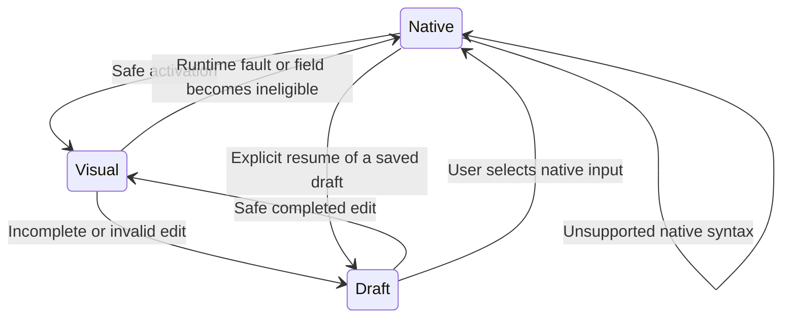

# Editor error and recovery model

Psetter must separate conversion validity from ownership of an answer field.
An expression that cannot be converted must not make its field unusable.
Incomplete input is an expected editing state, not a software failure.

## State and authority

Each field has three separate pieces of state:

- The visual draft: the exact MathQuill source, which may be incomplete.
- The native answer: the last value in the MITx field. MITx reads this value.
- Input ownership: the visual editor or the native field handles the next edit.

The converter returns a validity status and, when available, an explicit issue
kind. The interaction policy selects a message and recovery path. It does not
relax the conversion checks. Only a safe conversion can update the native field.

## Failure classes

| Class | Example | Required response |
| --- | --- | --- |
| Incomplete draft | A trailing plus, an empty fraction denominator, or a function awaiting an argument | Keep visual input and focus. Keep the native answer unchanged. Show no message or indicator during incomplete typing. Re-evaluate on the next edit. |
| Syntax problem | A completed expression that the parser reports as malformed | Keep the draft editable. Show that it is not synced. Allow correction or native entry. |
| Unsupported notation | An integral or another operation outside the local converter's supported grammar | Explain the limitation. Preserve the draft and native answer. Offer native entry for this field. |
| Semantic ambiguity | A function-like name without authoritative question context | Avoid guessing. Preserve both values. Allow correction or native entry. |
| Existing native syntax cannot round-trip | A native answer outside Psetter's supported grammar | Leave the native field uncovered. Explain why visual activation was declined. Do not repeat the same failed activation on each key or focus event. |
| Detection or integration change | A field becomes read-only, disabled, or a different input type | Release that field and remove its Psetter controls. Do not change the page's own restrictions. Re-detect it if it becomes eligible again. |
| Runtime fault | MathQuill or conversion code throws unexpectedly | Contain the fault at the editor boundary. Release and focus the native field. Preserve the native value. Allow an explicit visual retry. Other fields remain usable. |
| Grading rejection | MITx rejects a syntactically valid answer | MITx remains authoritative. Psetter must not infer correctness from local conversion success. |

An expected parser error node is syntax evidence. An unexpected exception is a
runtime fault. Error-message wording must not determine those categories.
Structural checks identify common incomplete drafts; they do not prove that all
remaining input is complete or that all supported syntax has been enumerated.

## Transitions

The visual draft stays separate from the native answer while blocked. Closing
or toggling the editor must not commit a partial conversion. An unfinished draft
can be kept in the existing bounded, page-local editor-state cache. It can be
restored only while its associated native answer is unchanged. A native edit
invalidates the older visual draft. Drafts are not uploaded or persisted across
a full page reload.

Native entry applies only to the current answer field and submission attempt.
Typing in that field does not silently reactivate the visual editor. Submitting
or resetting its form ends that turn; Psetter returns to the user's configured
mode the next time the field is activated. If a field has no form, native entry
lasts only for that field's lifetime. An explicit Resume visual editor action
can retry sooner without relaxing conversion or hydration checks.

## User feedback

A persistent sync problem can show the existing reset comment box directly
above the answer field after one second of inactivity. There is no exclamation
indicator. Incomplete typing stays silent. Editing or successful sync hides the
comment immediately. A status renderer that refers
to unmounted elements does not provide feedback. Non-synced states must explain
that MITx still has the previous answer. The feedback must not require the symbol
panel to be open or expose parser implementation details to the student.

Psetter does not replace MITx submission handling. The on-demand comment reports that
the visible draft has not replaced the native answer. It does not establish that
a grader will accept either expression.

## Verification

Run `corepack pnpm test:interactions` and `corepack pnpm extension:check`.
Regression tests cover incomplete-to-ready recovery, draft retention across
off/on cycles, native fallback, stale-draft invalidation, field eligibility
changes, and a simulated runtime fault with a second usable field.

Also test rendering, focus, keyboard navigation, and recovery in a real browser.
A synchronous parser that never returns requires a separate execution-budget
or worker design. Exception recovery cannot interrupt a blocked JavaScript
thread. The current tests do not prove that every possible input terminates.
